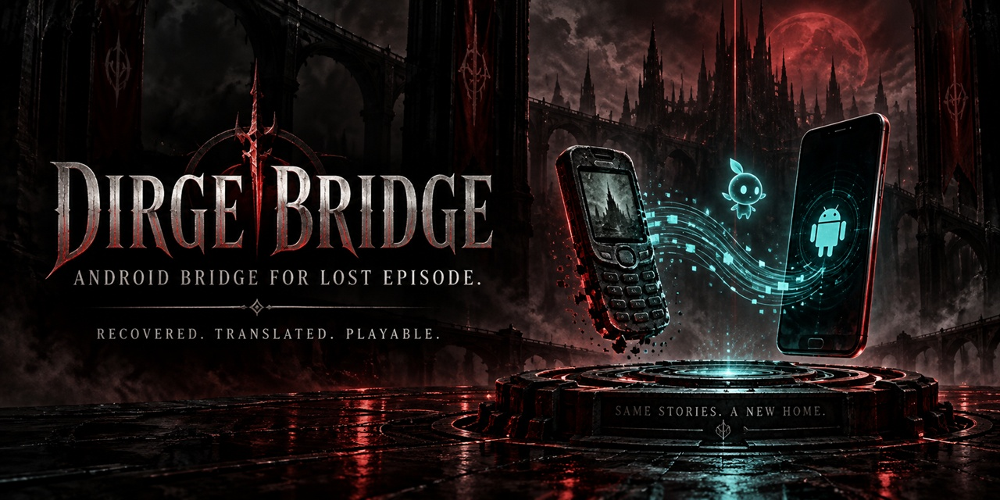

# Dirge Bridge

Dirge Bridge is an independent Android compatibility project that makes **Final Fantasy VII: Dirge of Cerberus – Lost Episode** playable on modern Android devices, with English text, audio, and touchscreen controls.

## Quick start

1. Open the [Releases](https://github.com/Wakkatobakka/Dirge-Bridge/releases/tag/v0.2.4) page and download `Dirge_Bridge_v0.2.4.apk`.
2. Install the APK on your Android device.
3. Prepare your English game-data ZIP using the instructions below.
4. Open Dirge Bridge and choose **Import English game data ZIP**.
5. Select your prepared ZIP.
6. Once the import is verified, choose **Enter Lost Episode**.

**Note:** Dirge Bridge does not include the original game files. You will need compatible Lost Episode game data.

## Preparing the game-data ZIP

You can obtain the original Lost Episode files through **Keitai World Launcher**.

[Keitai Archive](https://keitaiarchive.org/)

[Download Keitai World Launcher](https://keitaiarchive.org/downloads.html)

Once installed, download both:

1. **Final Fantasy VII: Dirge of Cerberus – Lost Episode** (original Japanese game package).
2. The separate **SD Card Data** download.

Keep both downloads as ZIPs or folders. You don't need to combine them manually.

You'll also need the English translation patch:

[Lost Episode English Translation – Yuvi / TurquoiseHammer](https://github.com/Yuvi-App/DoC-LE-English-Translation)

### Build your import ZIP (Windows)

Download **Dirge Bridge Payload Builder v0.2.1** from the [v0.2.4 release](https://github.com/Wakkatobakka/Dirge-Bridge/releases/tag/v0.2.4).

Before running the builder, install Android SDK Platform 35 and Android SDK Build-Tools 35.0.0 using Android Studio's SDK Manager.

1. Extract the Payload Builder ZIP.
2. Double-click `RUN-PAYLOAD-BUILDER-WINDOWS.bat`.
3. Select your original Lost Episode game package and SD Card Data download.
4. Choose **Yes** when asked if you're starting from the original Japanese game, then select your `DoCLE-Eng1.0.xdelta` translation patch.
5. Choose where to save the finished package.
6. Import the generated `Dirge_Lost_Episode_English_Data_for_Dirge_Bridge_v0.2.4.zip` into Dirge Bridge on your Android device.

Once verified, you're ready to play.

## Compatibility

Dirge Bridge v0.2.4 has been tested on a Samsung Galaxy S25 Ultra running Android 16.

Working features include graphics, English text, game audio, touchscreen controls, original checkpoint saving, and pause/resume functionality.

Compatibility with other Android devices and versions may vary.

## Translation attribution

The English translation used with Dirge Bridge is credited to:

- **Translation:** TurquoiseHammer
- **Hacking:** Yuvi
- **Playtesting:** Yuvi, TurquoiseHammer, Odysseus
- **Special thanks:** Shinra Archaeology

Dirge Bridge is an independent compatibility project and is not affiliated with Square Enix or NTT DOCOMO.

Third-party acknowledgments are available in [THIRD-PARTY-NOTICES.txt](THIRD-PARTY-NOTICES.txt).
